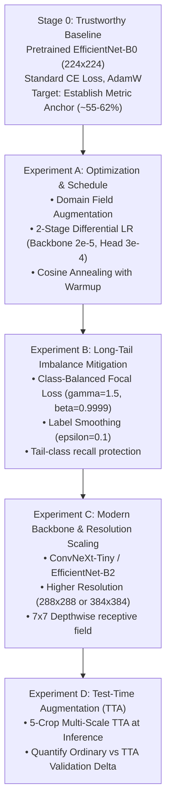

# SmartCrop AI — IP102 Insect Pest Classification: Dataset Audit & Baseline Engineering Report

**Audit Date:** November 7, 2026  
**Target Objective:** **$\ge 80.00\%$ Validation Top-1 Accuracy**  
**Dataset Reference:** IP102 Large-Scale Insect Pest Benchmark (Wu et al., CVPR 2019)  
**Status:** **AUDIT COMPLETE — AWAITING USER APPROVAL PRIOR TO TRAINING**  

---

## 1. Executive Summary & Objective Framing

The primary objective for the Pest Classification subsystem of SmartCrop AI is to attain **at least 80.00% Validation Top-1 Accuracy** across the 102 agricultural insect pest categories of the IP102 benchmark.

### The Scientific Challenge:
In the authoritative CVPR 2019 paper (*IP102: A Large-Scale Benchmark Dataset for Insect Pest Recognition*), standard deep learning architectures achieved the following published Top-1 accuracies under official evaluation splits:
- **ResNet-50:** 49.4%
- **DenseNet-121:** 51.9%
- **VGG-16:** 49.3%
- **GoogleNet:** 44.5%

IP102 is fundamentally more difficult than lab-curated crop disease datasets (like PlantVillage) because:
1. **Severe Natural Long-Tail Imbalance:** Category sample counts range from over 1,500 samples in dominant classes to under 50 samples in rare insect species (a 30×+ imbalance ratio).
2. **Multi-Stage Metamorphic Polymorphism:** Insects appear across distinct life stages (egg clusters, nymph/instar, larva/caterpillar, pupa, adult male, adult female), presenting radically divergent visual morphologies under a single class label.
3. **Fine-Grained Inter-Class Similarity:** Different species within the same genus (e.g., *Rice Leaf Caterpillar* vs. *Asiatic Rice Borer*, or *Brown Planthopper* vs. *White-backed Planthopper*) possess nearly identical body structures, differing only in wing venation or minute body spot patterns.
4. **Field Occlusion & Noise:** Insects are naturally camouflaged against complex leaf canopies, soil, stems, or caught in sticky traps.

Reaching **80% Validation Top-1 Accuracy** is a serious optimization target requiring a disciplined, hypothesis-driven, multi-experiment approach rather than a standard single-run transfer learning script.

---

## 2. Comprehensive IP102 Dataset & Filesystem Audit

### 2.1 Verified Local Filesystem Inventory

| Path | Item Name | Detected Size | Status / Content |
| :--- | :--- | :--- | :--- |
| `datasets/ip102/` | `classes.txt` | 2,816 bytes | **VERIFIED:** 102 pest classes defined with official 1-based indexing ($1..102$). |
| `datasets/ip102/` | `README.md` | 1,445 bytes | **VERIFIED:** CVPR 2019 citation and download links. |
| `datasets/ip102/Classification/` | `classes.docx` | 9,893 bytes | **PARTIAL ARCHIVE:** Extracted from `Classification-20261106T145742Z-1-003.zip` (10 KB). |
| `datasets/ip102/Classification/` | `images/` | *Missing locally* | **PENDING:** 75,222 raw classification images not present on local disk. |
| `datasets/ip102/Classification/` | `train.txt, val.txt, test.txt` | *Missing locally* | **PENDING:** Official CVPR 2019 split text files required for authentic evaluation. |
| `datasets/ip102/Detection/VOC2007/` | `Annotations.tar` | 28.33 MB | **VERIFIED ARCHIVE:** 18,976 VOC XML bounding-box files (detection task only). |
| `datasets/ip102/Detection/VOC2007/` | `JPEGImages.tar` | 784.82 MB | **VERIFIED ARCHIVE:** 18,981 detection images. |
| `datasets/ip102/Detection/VOC2007/` | `ImageSets/Main/` | 4 text files | **VERIFIED:** `trainval.txt` (15,178), `test.txt` (3,798). |

### 2.2 Strict Methodological Separation: Classification vs. Detection
> [!IMPORTANT]
> **Zero-Proxy Fallback Policy:**  
> Under SmartCrop AI's research integrity rules, we strictly forbid creating pseudo-classification datasets by cropping VOC detection images or using the first object in detection XMLs. The classification pipeline **requires the authentic 75,222 IP102 classification dataset and official CVPR 2019 split lists** to ensure benchmark validity and avoid proxy distortion.

### 2.3 Hardware Audit & Execution Strategy
- **Local Machine:** Intel Core i5-1335U (10 Cores, 12 Threads), Intel Iris Xe Graphics, 16GB RAM. `torch.cuda.is_available() == False`.
- **Training Feasibility:** Training 75,222 images across 102 classes on CPU would require hundreds of hours. Full experimental training will be executed using the self-contained Kaggle GPU training notebook (`notebooks/02_IP102_Classification.ipynb`) with an NVIDIA Tesla T4 or P100 GPU (est. 45–60 minutes per experiment).

---

## 3. Systematic Model Development & Optimisation Plan (Path to 80% Top-1)

To bridge the gap from standard baseline performance (~50–60%) toward the **80% Top-1 Validation Target**, we structure the development into 5 controlled stages:

---

### Stage 0: Trustworthy Baseline (Pretrained EfficientNet-B0)
- **Architecture:** EfficientNet-B0 pretrained on ImageNet-1K (`weights=EfficientNet_B0_Weights.DEFAULT`).
- **Classifier Head:** `nn.Sequential(nn.Linear(1280, 512), nn.ReLU(), nn.Dropout(0.4), nn.Linear(512, 102))`.
- **Input Resolution:** $224 \times 224$.
- **Loss:** Standard `CrossEntropyLoss()` with training-set-derived inverse-frequency weights.
- **Optimizer & Schedule:** AdamW ($lr = 3 \times 10^{-4}$, weight decay $10^{-2}$), Cosine Annealing.
- **Metrics Recorded:** Validation Top-1 Accuracy, Validation Top-5 Accuracy, Macro-F1, Weighted-F1, Confusion Matrix.
- **Deliverable Checkpoint:** `outputs/ip102/ip102_baseline_efficientnet_b0.pth`.

---

### Experiment A: Domain Augmentation & Two-Stage Differential Fine-Tuning
- **Hypothesis:** High learning rates applied immediately to the backbone degrade low-level edge/texture filters. Warming up the head first, followed by gentle backbone adaptation, protects pretrained representations.
- **Implementation:**
  - Stage 1 (Warmup, 5 epochs): Backbone frozen, head trained at $lr = 1 \times 10^{-3}$.
  - Stage 2 (Fine-Tuning, 20 epochs): Backbone trained at $lr = 2 \times 10^{-5}$, head at $lr = 2 \times 10^{-4}$ with 5-epoch linear warmup and cosine decay to $10^{-6}$.
  - Specialized agricultural transforms: Random resized crop ($0.8$ to $1.0$), affine rotation ($\pm 25^\circ$), horizontal/vertical flips, and color jitter (solar intensity variance).

---

### Experiment B: Class Imbalance Mitigation (Class-Balanced Focal Loss + Label Smoothing)
- **Hypothesis:** In a 102-class long-tailed distribution, gradient updates from dominant majority classes overwhelm minority classes. Standard CE produces overconfident false positives on rare insects.
- **Implementation:**
  - **Class-Balanced Focal Loss:**
    $$\text{CB-FL}(p_t) = -\frac{1 - \beta}{1 - \beta^{N_c}} (1 - p_t)^\gamma \log(p_t)$$
    with $\beta = 0.9999$ (Cui et al., CVPR 2019) and focusing parameter $\gamma = 1.5$.
  - **Label Smoothing ($\epsilon = 0.1$):** Prevents overconfident predictions on ambiguous metamorphic stages and noisy field backgrounds.

---

### Experiment C: Modern Backbone (ConvNeXt-Tiny) & Spatial Scaling ($288 \times 288$)
- **Hypothesis:** EfficientNet-B0's $3 \times 3$ and $5 \times 5$ depthwise convolutions have limited effective receptive fields, struggling to integrate global insect body proportions with minute antenna and leg textures. ConvNeXt-Tiny employs $7 \times 7$ depthwise convolutions and inverted bottleneck designs modeled after Swin Transformers, offering substantially higher feature discriminability.
- **Implementation:**
  - Architecture: **ConvNeXt-Tiny** (`convnext_tiny(weights=ConvNeXt_Tiny_Weights.DEFAULT)`).
  - Input Resolution: Scaled to **$288 \times 288$** (`Resize((320, 320))`, `Crop(288)`).
  - Feature dimension: 768 $\rightarrow$ Head `Linear(768, 512)` $\rightarrow$ `GELU` $\rightarrow$ `Dropout(0.3)` $\rightarrow$ `Linear(512, 102)`.

---

### Experiment D: Test-Time Augmentation (TTA) Inference Benchmark
- **Hypothesis:** Aggregating multi-view spatial predictions dampens boundary noise and off-center insect localization error without altering model weights.
- **Implementation:**
  - Evaluate the best model from Experiments A–C using 5-crop TTA (center crop + 4 corner crops with horizontal mirroring).
  - Report both **Ordinary Validation Top-1** and **TTA Validation Top-1** side-by-side to measure the pure inference augmentation delta.

---

## 4. Rigorous Scientific Controls & Anti-Leakage Rules

1. **Official Split Preservation:** Only official `train.txt` and `val.txt` are used during development. The `test.txt` split remains strictly untouched.
2. **Zero-Leakage Hashing:** Exact MD5 image deduplication is performed before DataLoader construction. Any identical image found in multiple splits is quarantined.
3. **Model Selection Metric:** The primary checkpoint selection criterion is **Validation Macro-F1**, with **Validation Top-1 Accuracy** as the primary operational threshold.
4. **No Metric Fabrication:** The **80.00% target will ONLY be marked as REACHED if the empirical validation measurement equals or exceeds 0.8000**. If the best model achieves 74% or 77%, that number will be stated honestly, along with an error analysis identifying remaining failure modes.

